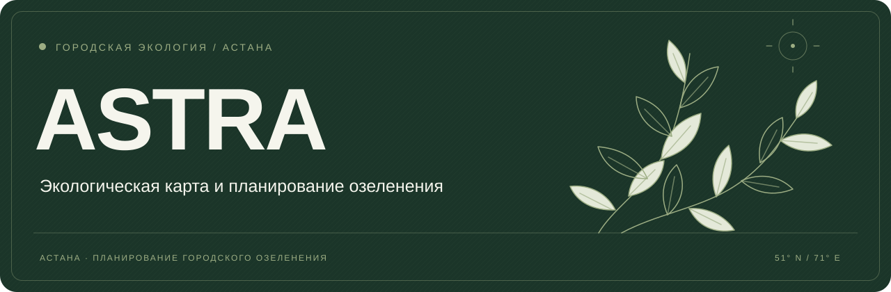
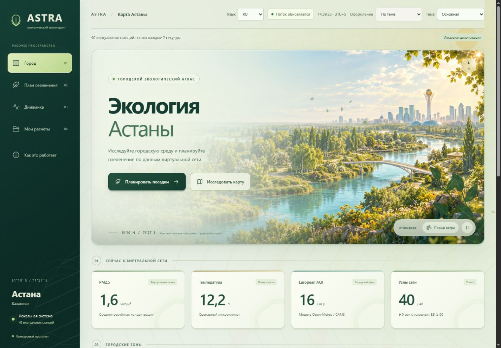
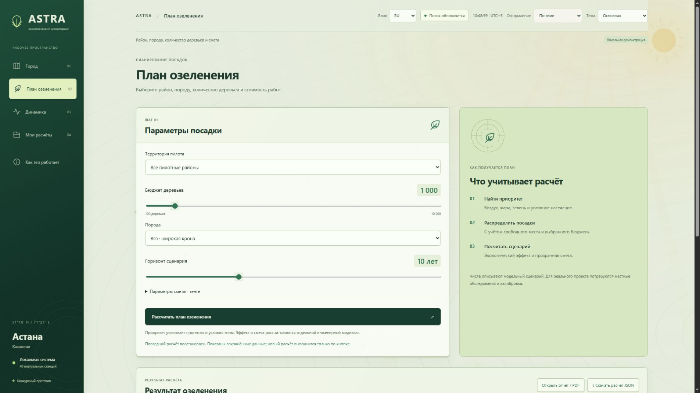
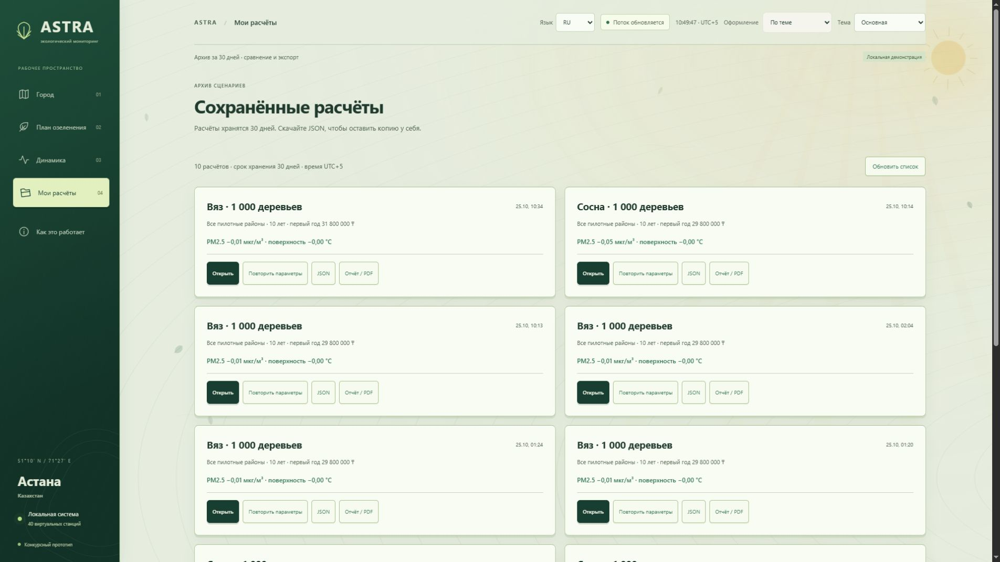
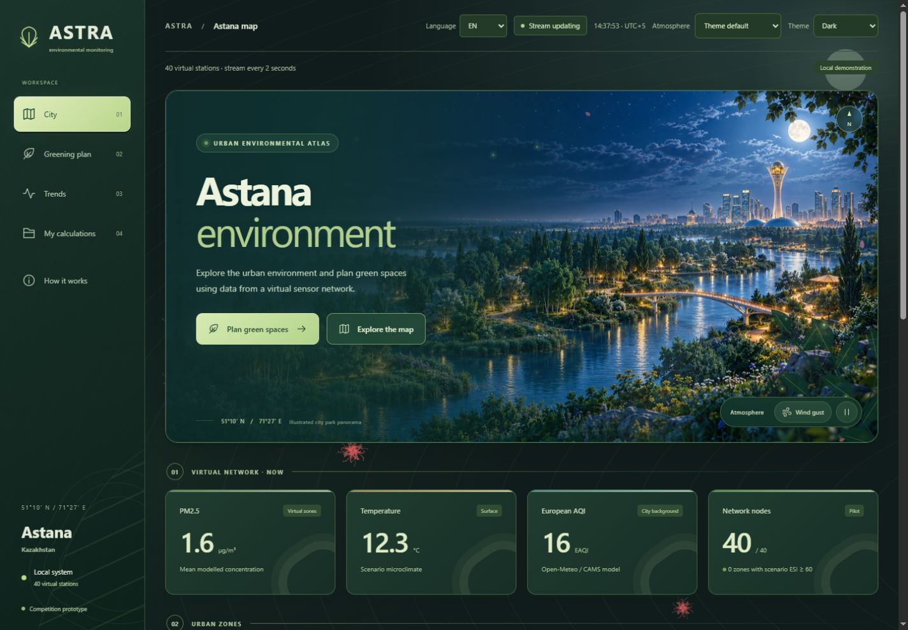
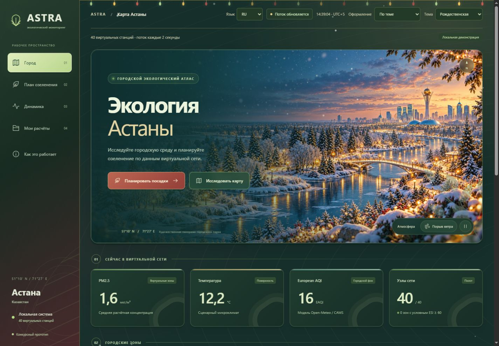
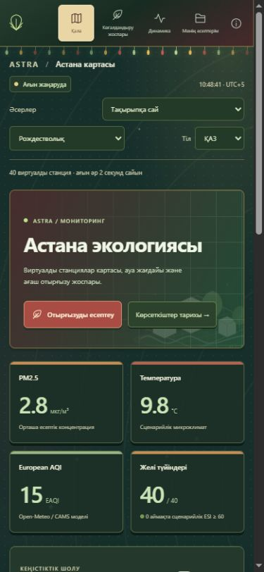

<div align="center">



<br>

**Экологическая карта и планирование озеленения.**

Показатели городской среды, расчёт посадок, сравнение сценариев и смета в одном приложении.

<a href="#features">Возможности</a> · <a href="#start">Запуск</a> · <a href="#interface">Интерфейс</a> · <a href="#data">О данных</a> · <a href="docs/TECHNICAL.md">Документация</a>

<br>

<sub>Астана, Казахстан &nbsp; / &nbsp; GreenHack Kazakhstan &nbsp; / &nbsp; Конкурсный прототип</sub>

</div>

<br>

<a id="features"></a>

## Возможности

ASTRA помогает сравнить условия в разных частях города и составить сценарий озеленения. Задайте район, породу и количество деревьев; приложение распределит посадки между подходящими зонами, оценит предполагаемый эффект и посчитает расходы.

<table>
<tr>
<td width="50%" valign="top">
<h3>01 · Карта и показатели</h3>
<p>Интерактивная карта 40 виртуальных зон со слоями ESI, PM2.5 и температуры. Поток обновлений и история за час или сутки — для города целиком и отдельной станции. Источник и свежесть данных видны в интерфейсе.</p>
</td>
<td width="50%" valign="top">
<h3>02 · План посадок</h3>
<p>Район, порода, бюджет деревьев и горизонт роста. Редактируемая смета, ограничения посадочной ёмкости и расчётные изменения PM2.5, температуры и связывания CO₂.</p>
</td>
</tr>
<tr>
<td width="50%" valign="top">
<h3>03 · Сохранённые расчёты</h3>
<p>Сохранённые планы, повтор параметров и сравнение двух сценариев. Основной прогноз PM2.5 и экспериментальный ML показаны отдельно; прогноз ESI можно исследовать через SHAP.</p>
</td>
<td width="50%" valign="top">
<h3>04 · Отчёт и экспорт</h3>
<p>Готовый отчёт с распределением деревьев, эффектами, затратами, источниками и допущениями. Выгрузка полного расчёта в JSON и светлая печатная версия для сохранения в PDF.</p>
</td>
</tr>
</table>

<br>

<a id="interface"></a>

## Интерфейс

Главный экран дополнен иллюстрированным природным атласом с дневной, ночной и зимней панорамами, параллаксом и управляемым ветром — [оформление и происхождение графики](docs/ATLAS_DESIGN.md).

Рабочий интерфейс в лесных и шалфейных тонах, с лёгкой текстурой, шрифтом Segoe UI и заметными заголовками. Карта, показатели и инструменты собраны компактно. Слои ESI, PM2.5 и температуры переключаются на карте; подробности зоны открываются по выбору. Основные разделы: **Обзор, Планирование, Аналитика, Мои расчёты**.

Доступны **основная, тёмная и рождественская темы**, а также **русский, английский и казахский языки (RU / EN / ҚАЗ)**. Выбор сохраняется между запусками. Язык переключается без сброса формы; интерфейс, сообщения, графики и печатный отчёт переведены.

<p align="center">
  
  <br>
  <sub>Природный атлас — дневная панорама, движение ветра и рабочие показатели городской среды.</sub>
</p>

<table>
<tr>
<td width="50%" valign="top">

<p><strong>Параметры и результат расчёта.</strong><br><sub>Посадки, предполагаемый эффект и стоимость в одном разделе.</sub></p>
</td>
<td width="50%" valign="top">

<p><strong>Сохранённые планы.</strong><br><sub>Расчёты можно открыть, сравнить, выгрузить или использовать как основу нового плана.</sub></p>
</td>
</tr>
</table>

В режиме «По теме» основная тема показывает солнце и листья на ветру, тёмная — луну и ликорисы, рождественская — снег и огни. В рождественской теме Санта пролетает на пять секунд каждые две минуты активной вкладки. Эффекты можно переключить или отключить; системная настройка уменьшения движения отключает анимацию. Оформление не обозначает фактическую погоду.

<table>
<tr>
<td width="50%" valign="top">

<p><strong>Тёмная тема.</strong><br><sub>Лунный парк, тёплые фонари и светящиеся частицы.</sub></p>
</td>
<td width="50%" valign="top">

<p><strong>Рождественская тема.</strong><br><sub>Зимняя панорама, падающий снег и мягкие огни.</sub></p>
</td>
</tr>
</table>

<details>
<summary><strong>Мобильный интерфейс на казахском</strong></summary>
<br>
<p align="center"></p>
</details>

<br>

<a id="start"></a>

## Запустить у себя

**Windows · Python 3.12 · один локальный процесс.** Для обычной работы Node.js и Docker не нужны.

### 1. Подготовить окружение

В папке проекта выполните один раз:

```powershell
py -3.12 -m venv .venv
.\.venv\Scripts\python.exe -m pip install -r requirements.lock.txt
```

Если `.venv` уже настроено, переходите к следующему шагу.

### 2. Открыть ASTRA

Дважды нажмите **[`start.cmd`](start.cmd)** или выполните:

```powershell
.\start.cmd
```

### 3. Перейти к приложению

Откройте **[127.0.0.1:8010](http://127.0.0.1:8010/)** в браузере. Сервер работает локально; окно запуска должно оставаться открытым. Для остановки нажмите `Ctrl+C` в этом окне.

<details>
<summary><strong>Автономный режим и диагностика</strong></summary>

<br>

```powershell
.\start.cmd --check
.\start.cmd --offline
```

`--check` проверяет окружение и файлы без запуска сервера. `--offline` отключает запросы к Open-Meteo и использует пригодный кэш либо явно отмеченный резервный фон. Картографическая подложка требует сети; при её отсутствии виртуальные зоны и расчёты остаются доступны.

Запуск отдельного экземпляра:

```powershell
.\start.cmd --offline --port 8011 --data-dir artifacts/offline-demo
```

Для отдельного экземпляра нужны **другой порт и другой каталог данных**. Занятый порт не освобождается автоматически, чужие процессы не останавливаются.

</details>

<br>

<a id="data"></a>

## Данные с понятным происхождением

> **ASTRA — конкурсный прототип.** Open-Meteo / CAMS предоставляет модельный городской фон. Все 40 узлов, локальный трафик, NDVI и микроклимат — симуляция. Это не сеть действующих городских датчиков.

Основной прогноз PM2.5 сохраняет текущее значение: на проверенных синтетических временных блоках этот ориентир оказался точнее ML-кандидатов в среднем. LightGBM PM2.5 доступен для экспериментального сравнения, а ESI прогнозируется отдельной моделью. Качество на реальных наблюдениях Астаны пока не установлено.

Эффект озеленения и цены рассчитаны по раскрытым сценарным допущениям. SHAP объясняет поведение ML, а не доказывает причинный эффект посадки. Сохранённые планы доступны **30 дней**; для собственного архива скачайте JSON.

[Происхождение данных, формулы и ограничения →](docs/TECHNICAL.md)

<br>

## Под капотом

**FastAPI + WebSocket** для потока данных · **SQLite** для локального хранения · **LightGBM + SHAP** для экспериментов и объяснений · **Leaflet + Plotly** для карты и графиков.

| Если нужно… | Открыть |
|---|---|
| Разобраться в запуске, настройках, API и формулах | [Техническое руководство](docs/TECHNICAL.md) |
| Посмотреть фактические результаты проверок | [Приёмка проекта](VERIFICATION.md) |
| Повторить сравнение моделей PM2.5 | [Исследовательский стенд](benchmarks/pm25/README.md) |
| Открыть пример расчёта | [Пример JSON](examples/optimization.sample.json) |
| Изучить HTTP API работающего приложения | [Swagger UI](http://127.0.0.1:8010/docs) |

Презентация отложена по решению пользователя; [сохранённый бриф](docs/PRESENTATION_BRIEF.md) остаётся основой для следующего этапа.

В репозитории также подготовлен вариант PostgreSQL + Redis через Docker Compose. Его настоящий запуск в исходной среде разработки не проверялся; это ограничение раскрыто в документации.

<details>
<summary><strong>Быстрые проверки</strong></summary>

<br>

```powershell
.\.venv\Scripts\python.exe scripts\check.py
.\.venv\Scripts\python.exe scripts\acceptance.py --seconds 30
```

Приёмка запускает отдельный автономный экземпляр, проверяет поток, расчёт и восстановление после перезапуска. Рабочая база не затрагивается. Результаты сохраняются в `artifacts/acceptance/`. Последняя проверка: **46 Python-тестов за 12,35 с и 23 JavaScript-теста за 0,162 с**; короткий поток — **31,76 с**, 16 обновлений и 640 записей без ошибок health-check. Подробности и ограничения — в [VERIFICATION.md](VERIFICATION.md).

</details>

<br>

---

<div align="center">

<sub>ASTRA · Астана · GreenHack Kazakhstan</sub><br>
<sub>Источники: Open-Meteo / CAMS и OpenStreetMap. Авторство, зависимости и использование ИИ раскрыты в <a href="docs/TECHNICAL.md">техническом руководстве</a>.</sub>

</div>
