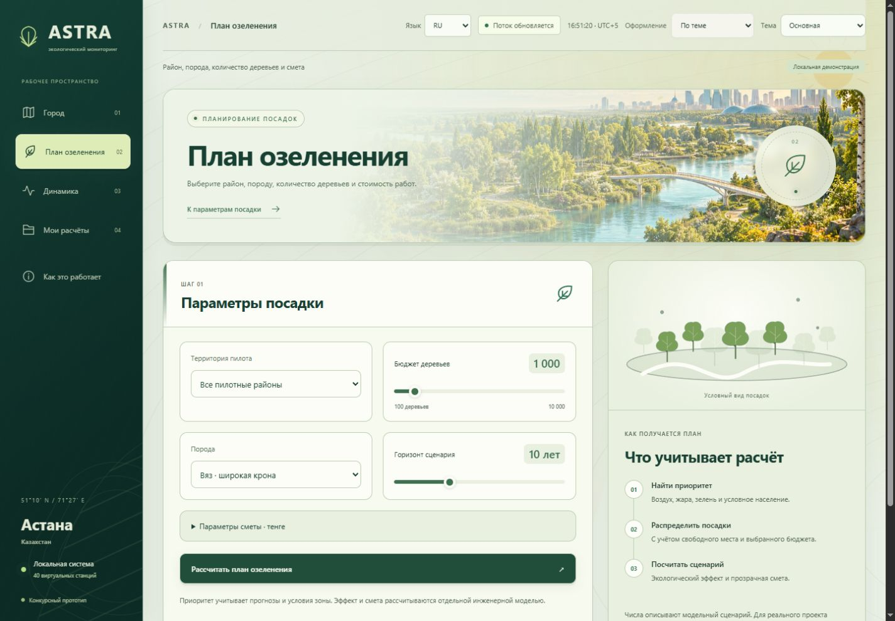
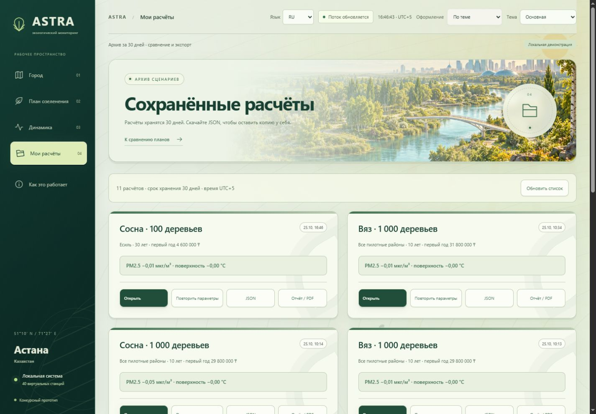

<div align="center">


**Air & Surface Temperature Real-time Analytics**

Карта городской среды, сценарии озеленения и понятная смета для Астаны.


[Возможности](#возможности) · [Запуск](#быстрый-запуск) · [Демонстрация](#демонстрация) · [О данных](#о-данных) · [Документация](#документация)

<sub>Астана, Казахстан · GreenHack Kazakhstan · Конкурсный прототип</sub>

</div>

## Для чего ASTRA

ASTRA помогает сравнить условия в разных частях города и составить план посадок. Выберите территорию, породу, количество деревьев и срок роста — приложение распределит посадки по подходящим участкам, оценит модельный эффект и рассчитает расходы. Два сохранённых варианта можно сравнить, а результат — передать в виде отчёта.


## Возможности

| Раздел | Что можно сделать |
|---|---|
| **Обзор** | Изучить карту 40 расчётных участков, показатели воздуха, температуры и зелени; открыть подробности выбранной зоны. |
| **Планирование** | Выбрать вяз, сосну или тополь, количество деревьев и горизонт роста. Получить распределение посадок и редактируемую смету в тенге. |
| **Аналитика** | Посмотреть текущие значения и историю; исследовать прогноз и вклад факторов в расчёт. |
| **Мои расчёты** | Сохранить сценарий, повторить параметры, сравнить два варианта, выгрузить JSON и печатный отчёт для PDF. |

**Три языка:** русский, английский и казахский. **Три темы:** дневная, тёмная и рождественская. Язык и оформление сохраняются между запусками. Природные сцены, движение света и фоновые эффекты связывают разделы в единый интерфейс.

<table>
<tr>
<td width="50%"><br><strong>Планирование посадок</strong></td>
<td width="50%"><br><strong>Сохранение и сравнение</strong></td>
</tr>
<tr>
<td width="50%"><br><strong>Тёмная тема</strong></td>
<td width="50%"><br><strong>Рождественская тема</strong></td>
</tr>
</table>

## Быстрый запуск

Для локального запуска нужен **Python 3.12**. Node.js требуется только для проверок JavaScript и сборки сторонних ресурсов.

### Windows

```powershell
git clone https://github.com/GL1NoMe5/A.S.T.R.A.git
cd A.S.T.R.A
py -3.12 -m venv .venv
.\.venv\Scripts\python.exe -m pip install -r requirements.lock.txt
.\start.cmd
```

Откройте **http://127.0.0.1:8010/**. После установки зависимостей приложение также запускается двойным нажатием на `start.cmd`. Остановка — `Ctrl+C` в окне сервера.

```powershell
.\start.cmd --check       # Проверка окружения
.\start.cmd --offline     # Без запросов к внешним источникам
```

### Linux / macOS

```bash
python3.12 -m venv .venv
source .venv/bin/activate
pip install -r requirements.txt
python scripts/run_local.py
```

### Docker

```bash
docker compose up --build
```

Docker-версия использует PostgreSQL и Redis и открывается на **http://127.0.0.1:8000/**. Обычный локальный запуск использует SQLite и очередь внутри процесса. Настройки и переменные окружения описаны в [.env.example](.env.example) и [технической документации](docs/TECHNICAL.md).

## О данных

Городской фон поступает из **Open-Meteo / CAMS**. При отсутствии сети используется кэш или резервный фон. Значения для 40 локальных участков формируются сценарной моделью: прототип не подключён к сети из 40 физических датчиков. Положение участков связано с городскими ориентирами; площадь, доступность посадок и другие параметры требуют проверки на месте.

**PM2.5** — мелкая пыль и дым в воздухе. **ESI** — собственный сводный индекс состояния среды от 0 до 100. Оценки охлаждения, частиц и CO₂ описывают модельный сценарий; они не являются полевыми измерениями или гарантией эффекта. Источники, коэффициенты и ограничения приведены в [реестре модели](docs/PROJECT_EVIDENCE.md) и [описании пилотных участков](docs/PILOT_NETWORK.md).

Карта использует OpenStreetMap; подложка требует подключения к сети. Источник фоновых данных и его свежесть видны в приложении. Локальная база, сохранённые расчёты и кэш создаются в `data/` и не включены в репозиторий.

## Демонстрация

Сохранены два выбранных варианта ролика — по 30 секунд, Full HD, 60 fps:

- [**ASTRA v2** — динамичный проморолик](media/demos/ASTRA-v2.mp4).
- [**ASTRA v3** — «Место для тени», объёмный город и озеленение](media/demos/ASTRA-v3.mp4).

[Презентация PowerPoint](docs/presentation/ASTRA_GreenHack.pptx) · [Презентация PDF](docs/presentation/ASTRA_GreenHack.pdf) · [Заметки для выступления](docs/presentation/speaker-notes.md)

Сведения о музыкальных записях и правах на демонстрационные материалы — в [media/CREDITS.md](media/CREDITS.md).

## Проверки

```powershell
.\.venv\Scripts\python.exe scripts/check.py --javascript
```

Команда запускает Python-тесты и короткие проверки JavaScript. Node.js нужен для части `--javascript`. Короткая сквозная приёмка:

```powershell
.\.venv\Scripts\python.exe scripts/acceptance.py --seconds 30
```

Результаты и границы проверки — [VERIFICATION.md](VERIFICATION.md). Воспроизводимые эксперименты находятся в [benchmarks/](benchmarks/).

## Документация

- [Устройство приложения и API](docs/TECHNICAL.md).
- [Источники, допущения и доказательная база](docs/PROJECT_EVIDENCE.md).
- [Пилотные участки Астаны](docs/PILOT_NETWORK.md).
- [Оформление и происхождение графики](docs/ATLAS_DESIGN.md).
- [Описание проекта для выступления](HACKATHON_PITCH.md).
- [Пример расчёта](examples/README.md).

```text
app/          API, модели, данные участков и интерфейс
benchmarks/   Воспроизводимые эксперименты
scripts/      Запуск, диагностика и проверки
tests/        Тесты приложения и интерфейса
docs/         Документация, скриншоты и презентация
media/        Готовые демонстрационные ролики
examples/     Пример выгрузки расчёта
```

## Лицензия

Исходный код проекта распространяется по [MIT](LICENSE). Сторонние библиотеки и музыкальные записи сохраняют собственные условия — [THIRD_PARTY_NOTICES.md](THIRD_PARTY_NOTICES.md).
