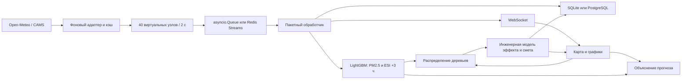

# ASTRA

ASTRA — работающий конкурсный прототип для планирования городской зелёной инфраструктуры Астаны. Он получает модельный городской фон Open-Meteo, рассчитывает поток 40 виртуальных станций, прогнозирует PM2.5 и собственный индекс нагрузки ESI через три часа, объясняет прогноз через SHAP и распределяет деревья между приоритетными зонами.

Пользователь — специалист городской службы по экологии или озеленению. Результат работы — воспроизводимый сценарий: где разместить ограниченное число деревьев, какой эффект предполагает инженерная модель и сколько стоит пилот при заданных ценах.

## Что означают данные

| Компонент | Происхождение и ограничения |
|---|---|
| Городской фон | Публичные погодный и воздушный API Open-Meteo; это модельные данные, не показания датчиков ASTRA |
| Воздух Астаны | CAMS Global, сетка порядка 45 км; частота опроса 5 минут не равна частоте новых исходных данных |
| 40 узлов | Виртуальные пилотные зоны в пяти районах из концепции проекта; координаты и районная привязка условные |
| NDVI, трафик, плотность, население | Сценарные параметры; не спутниковые продукты, дорожные измерения или перепись |
| PM2.5, PM10, NO₂, CO узлов | Расчётные отклонения от фоновых значений |
| CO₂ узлов | Самостоятельная симуляция в ppm; CO из API хранится отдельно в мкг/м³ |
| Температура поверхности | Расчёт из температуры воздуха, условной застройки, NDVI и времени суток |
| Прогноз ML | Две настоящие модели LightGBM, обученные на 5000 синтетических строках |
| SHAP | Точные вклады признаков в прогноз модели; не доказательство причинного действия озеленения |
| European AQI | Готовый модельный городской индекс Open-Meteo, отдельно от ESI и средних концентраций виртуальной сети |
| Эффект и стоимость | Инженерно-экономический сценарий с раскрытыми коэффициентами и редактируемыми ценами |

Пять выбранных районов не представляют собой полный актуальный административный перечень Астаны. Положение датчиков не утверждает реальные границы районов. В интерфейсе и JSON всегда указано происхождение данных; результаты полевых испытаний не заявляются.

## Быстрый локальный запуск в Windows

В текущем рабочем каталоге уже подготовлено окружение `.venv`. Запуск из PowerShell:

```powershell
cd D:\CodexProjects\A.S.T.R.A
.\.venv\Scripts\python.exe -m uvicorn app.main:app --host 127.0.0.1 --port 8010 --workers 1
```

Откройте [дашборд](http://127.0.0.1:8010), [описание API](http://127.0.0.1:8010/docs) или [проверку состояния](http://127.0.0.1:8010/health). В текущей среде порт 8000 занят другим процессом, поэтому локальная демонстрация использует 8010. Остановка — `Ctrl+C` в терминале сервера.

Для новой копии проекта нужны Python 3.12 и интернет для установки пакетов:

```powershell
py -3.12 -m venv .venv
.\.venv\Scripts\python.exe -m pip install -r requirements.lock.txt
.\.venv\Scripts\python.exe -m uvicorn app.main:app --reload --port 8010
```

Если установлен `uv`, окружение можно создать так:

```powershell
uv venv --python 3.12 .venv
uv pip install --python .venv\Scripts\python.exe -r requirements.lock.txt
```

`requirements.lock.txt` фиксирует проверяемый набор для Python 3.12 / Windows x64. `requirements.txt` задаёт диапазоны для переносимого разрешения зависимостей. Для Linux используйте `requirements.txt`; зависимости Uvicorn выбираются по платформе. Скрипт `scripts/download_wheels.mjs` — дополнительный способ загрузки Windows wheels при проблемах сетевого клиента установщика; он проверяет SHA-256 из PyPI. Для обычного запуска Node.js не нужен.

Вендорные Leaflet и Plotly включены локально. Если они удалены, восстановление:

```powershell
.\.venv\Scripts\python.exe scripts\vendor_assets.py
```

Внешняя карта OpenStreetMap требует сети. При недоступности тайлов узлы и все расчёты продолжают работать на нейтральной подложке. Интерфейс использует собственные стили и предварительно собранные утилиты Tailwind 3.4.17, без браузерного компилятора и внешних шрифтов. Обычный запуск не требует Node.js. Только при изменении набора Tailwind-утилит разработчик пересобирает CSS:

```powershell
npx --yes tailwindcss@3.4.17 -c tailwind.config.cjs -i app/static/tailwind.input.css -o app/static/vendor/tailwind.css --minify
```

## Запуск в Docker

Нужны Docker Engine / Docker Desktop с Compose:

```powershell
docker compose up --build -d
docker compose logs -f astra
```

Приложение доступно на `http://127.0.0.1:8000`. В Compose используются PostgreSQL 15, Redis 7 с AOF и один экземпляр приложения. Сервисы данных не публикуют порты на хосте. Пароль по умолчанию предназначен для локальной демонстрации; для иной среды задайте `POSTGRES_PASSWORD` до запуска. Удаление контейнеров без удаления данных:

```powershell
docker compose down
```

Контейнерный запуск в исходной среде разработки недоступен: Docker здесь не установлен. Статическая проверка Compose и тесты контракта Redis не заменяют проверку настоящих контейнеров. Проверяемым способом запуска в этой среде является локальный режим.

## Поток обработки



Один Uvicorn worker управляет жизненным циклом фоновых задач. Несколько workers или несколько реплик создадут несколько симуляторов: масштабирование требует выделения генератора и общей доставки WebSocket. При корректном завершении задачи отменяются, соединения закрываются.

SQLite работает в WAL-режиме. Сырые записи хранятся час, минутные агрегаты — сутки; очистка выполняется каждые 30 пакетов. Сырые записи уникальны по `(sensor_id, timestamp)`, поэтому повторная доставка не увеличивает счётчики минутных агрегатов. Redis-сообщение подтверждается после обработки; незавершённые сообщения одного потребителя перечитываются при запуске. Поток ограничен 256 пакетами, очередь в памяти — 32, буфер браузера — 300 точек. Это ограниченное демонстрационное хранение, не архив с гарантией отсутствия потерь при длительном отказе.

## Режимы и настройки

Настройки читаются из переменных `ASTRA_*` и необязательного `.env`; пример — `.env.example`.

| Параметр | Значение по умолчанию | Назначение |
|---|---|---|
| `ASTRA_MODE` | `auto` | `auto`, `local`, `docker` |
| `ASTRA_DATA_DIR` | `data` | SQLite, кэш источника и артефакт модели |
| `ASTRA_BACKGROUND_ENABLED` | `true` | Отключение внешних запросов для автономной проверки |
| `ASTRA_BACKGROUND_INTERVAL_SECONDS` | `300` | Период опроса каждого из двух источников |
| `ASTRA_HTTP_TIMEOUT_SECONDS` | `10` | Сетевой таймаут |
| `ASTRA_CACHE_MAX_AGE_SECONDS` | `86400` | Максимальный возраст получения используемого кэша |
| `ASTRA_TICK_SECONDS` | `2` | Период виртуальной телеметрии |
| `ASTRA_DATABASE_URL` | не задан | Асинхронный PostgreSQL URL |
| `ASTRA_REDIS_URL` | не задан | Redis URL |
| `ASTRA_SEED` | `42` | Воспроизводимость симуляции и обучения |

`auto` без инфраструктурных URL сразу выбирает SQLite + Queue. Если оба URL заданы, проверяется вся пара; ошибка приводит к локальному режиму с объяснением в `/health`. Явный `docker` требует доступности PostgreSQL и Redis. После старта приложение не меняет хранилище автоматически.

Воздух и погода кэшируются независимо. Неуспешный запрос сохраняет предыдущий ответ со статусом `cached`; без пригодного кэша используется `default`. Данные с диска считаются кэшированными до успешной проверки API. Поля `source_time` и `fetched_at` не смешиваются. Резервные значения — PM2.5 20, PM10 32, NO₂ 25, CO 250 мкг/м³; температура воздуха 8 °C, влажность 65%, ветер 3 м/с, направление 240°. Это раскрытые сценарные допущения. При резервном фоне European AQI отсутствует, а не равен нулю.

## ML и проверка качества

Обучающие данные: 40 узлов × 125 моментов с шагом три часа, плюс служебная будущая точка. Генератор охватывает несколько синтетических погодных режимов. Признаки истории и текущего потока формируются одинаково. Две модели прогнозируют `pm25(t+3h)` и `ESI(t+3h)`.

Разделение общее по времени для всех узлов: признаки обучения до шага 98 включительно, последняя обучающая цель — шаг 99; контроль начинается с признаков шага 100. Временной зазор — три часа. Контрольные метрики сравниваются с сохранением текущего значения. Модель не обязана выигрывать у базового прогноза на каждом сценарии; интерфейс показывает оба результата.

Текущий ESI версии 1:

```text
clip(x) = min(1, max(0, x))
ESI = 100 × [0.5 × clip(PM2.5 / 100)
           + 0.2 × clip(NO₂ / 100)
           + 0.3 × clip((Tповерхности − 25) / 20)]
```

Нормирующие значения — внутренние сценарные параметры, не нормы безопасности и не медицинские пороги. SHAP рассчитывается по запросу. Его базовое значение и вклады суммируются до исходного прогноза; отдельное физическое ограничение отображаемого прогноза раскрывается в ответе. Артефакт модели кешируется с сигнатурой версии, признаков, зон и seed. Не загружайте чужие joblib/pickle в каталог данных.

## Формулы озеленения

Все численные параметры пород ниже являются иллюстративными допущениями. Источники объясняют механизмы и общие порядки величин, но не подтверждают эту таблицу как калибровку для Астаны.

| Порода | Крона при зрелости, м² | LAI | Осаждение, м/с | Приживаемость | CO₂, кг/дерево/год | Предельное охлаждение, °C |
|---|---:|---:|---:|---:|---:|---:|
| Вяз | 25 | 3 | 0,0020 | 0,85 | 22 | 4 |
| Сосна | 18 | 3,5 | 0,0025 | 0,80 | 18 | 3 |
| Тополь | 35 | 3 | 0,0018 | 0,80 | 28 | 5 |

```text
g = min(1, горизонт_лет / 10)
Nживых = N × приживаемость
Aкроны = min(Aзоны × (1 − NDVI), Nживых × площадь_кроны × g)
s = 1 при Tвоздуха > 10 °C; иначе 0.6 для сосны, 0.12 для лиственных
Aлистьев = Aкроны × LAI × s
τ = 3600 секунд / (1 + ветер / (1 м/с))
V = Aзоны × 20 м
доля_снижения_PM = min(0.35, 1 − exp(−Vd × Aлистьев × τ / V))
ΔPM2.5 = PM2.5до × доля_снижения_PM
PM2.5после = PM2.5до − ΔPM2.5
тепловой_фактор = clip((Tвоздуха − 10) / 20)
ΔTповерхности = Tmax × (1 − exp(−3 × Aкроны / Aзоны)) × тепловой_фактор
CO₂_тонн_в_год = Nживых × CO₂_кг_на_дерево × g / 1000
```

Основной механизм осаждения: `F = Vd × C × Aлистьев`, где поток частиц `F` измеряется в мкг/с. Упрощённая модель воздушного объёма переводит его в сценарное изменение концентрации; она не моделирует аэродинамику уличных каньонов. Плотная посадка в некоторых условиях может ухудшать вентиляцию — это ограничение требует отдельной проверки при реальном проектировании.

Зоны выбираются по прогнозной нагрузке, жаре, недостатку зелени и условному населению; небольшой бонус близости способствует связности. Деревья распределяются по предельному выигрышу с ограничением ёмкости зоны. До десяти пригодных зон; при выборе одного района их не более восьми. Остаток бюджета возвращается явно. Средние концентрации и температуры взвешиваются по площади выбранных зон; население суммируется один раз по непересекающимся условным ячейкам. Диапазон ×0,5–1,5 — сценарная чувствительность, не доверительный интервал.

Смета первого года: `N × (саженец + посадка + годовой уход) + оборудование + годовое сопровождение`. Смета горизонта: `N × (саженец + посадка) + оборудование + годы × (N × годовой уход + годовое сопровождение)`. Инфляция, дисконтирование, замена погибших деревьев и доходы в эту простую смету не входят. Цены можно изменить перед расчётом.

## API

| Метод и адрес | Назначение |
|---|---|
| `GET /health` | Жизнеспособность потока, выбранный режим и статусы источников |
| `GET /api/v1/background` | Фон, происхождение, единицы и время |
| `GET /api/v1/sensors` | Метаданные всех узлов и последние значения |
| `GET /api/v1/telemetry/history?minutes=60&sensor_id=AST-001` | Минутная история; узел необязателен; максимум 1440 минут |
| `GET /api/v1/analytics/explain/AST-001?target=pm25` | SHAP; `target=pm25` или `esi` |
| `POST /api/v1/optimize/greening` | Сценарий озеленения, показатели, смета, источники и допущения |
| `GET /api/v1/methodology` | Формула ESI и параметры пород |
| `GET /api/v1/metrics` | Метрики ML и потока |
| `WS /ws/telemetry` | Полный начальный `snapshot`, затем пакеты `telemetry` |

Пример оптимизации:

```json
{"budget_trees":1000,"species":"elm","target_district":"all","horizon_years":10}
```

Допустимые породы: `elm`, `pine`, `poplar`; районы: `all`, `yesil`, `nura`, `almaty`, `saryarka`, `baikonyr`. Необязательные поля сметы описаны в Swagger. Результат скачивается из дашборда в JSON с входными параметрами, снимком фона, временем, коэффициентами и итогами.

## Печатный отчёт

После расчёта плана нажмите **«Открыть отчёт / PDF»** рядом с выгрузкой JSON. В той же вкладке откроется ведомость с текущими параметрами, участками, эффектами, сметой и источниками. Снимок сохраняется в `sessionStorage` этой вкладки; повторного расчёта и передачи JSON по сети нет. Перезагрузка страницы отчёта сохраняет этот снимок. Вернуться в приложение можно ссылкой «К дашборду».

Сохранённый ранее JSON можно открыть через **«Отчёт из JSON»** внизу дашборда или напрямую на `/static/report/report.html`. Выберите файл и нажмите «Печать / сохранить PDF»: используются светлые стили A4, элементы управления скрываются. Три файла `app/static/report/report.html`, `report.css`, `report.js` также можно скопировать вместе для автономного просмотра локальных файлов без сервера.

Лимит входа — 5 МиБ реального UTF-8, включая программную загрузку. Проверяются типы, конечность чисел и даты; `european_aqi: null` разрешён для резервного фона. При ошибке старый отчёт скрывается, печать блокируется. Если браузер запрещает хранилище вкладки, используйте сохранение и ручную загрузку JSON. Отчёт отображает готовый результат, не меняя формулы.

## Проверки

```powershell
.\.venv\Scripts\python.exe -m pytest -q
.\.venv\Scripts\python.exe scripts\smoke_test.py --seconds 60
node --test tests/report.test.cjs
```

Для второго вызова сервер должен работать. Прогон длится 30–60 секунд; длинные состояния кэша и хранения проверяются тестами с изменением времени данных. В тестах внешняя сеть отключена или подменена контролируемыми ответами. Проверяются API и SQLite, повторная доставка, минутные агрегаты, временное разделение ML, аддитивность SHAP, смета, бюджет/район/ёмкость, отказы источников, перезапуск и WebSocket. Отдельный документ `VERIFICATION.md` содержит фактические результаты приёмки.

## Пилот и дальнейшая работа

Реализованный прототип демонстрирует программный конвейер. Для настоящего пилота нужны полевые датчики и их сопоставление с эталоном, сведения о посадочных площадях, городской инвентаризации деревьев и населении, проверка пород агрономом, сезонное наблюдение и локальная калибровка. Интеграции LoRaWAN, Казгидромета и Sentinel-2 являются будущими работами. Для производственного применения также нужны аутентификация, управление доступом, наблюдаемость, резервное копирование и отдельная схема масштабирования.

Отчёт Argon проверен, исправлен и интегрирован в `app/static/report/`. Папка `argon-delivery/` сохраняет исходную поставку с тремя исправлениями для сравнения; приложение использует только `app/static/report/`. Дальнейшие изменения отчёта вносятся в рабочую копию приложения.

## Источники и использование ИИ

- [Open-Meteo Air Quality API](https://open-meteo.com/en/docs/air-quality-api), [Weather API](https://open-meteo.com/en/docs), [условия](https://open-meteo.com/en/terms), [CC BY 4.0](https://creativecommons.org/licenses/by/4.0/). Источник воздушного фона — CAMS; преобразования виртуальных зон выполнены ASTRA. Бесплатный API используется для некоммерческого конкурсного прототипа; коммерческий запуск требует пересмотра условий доступа.
- [Казгидромет, обновление сети мониторинга Астаны, 2 июля 2025](https://www.kazhydromet.kz/ru/post/3021).
- [Бюро национальной статистики, охрана атмосферного воздуха за 2025 год](https://stat.gov.kz/ru/industries/environment/stat-eco/publications/346639/).
- [i-Tree Eco, описание сухого осаждения](https://www.itreetools.org/eco/resources/iTree_Eco_Dry_Deposition_Model_Descriptions.pdf).
- [Nowak et al., 2013, углерод городских деревьев](https://research.fs.usda.gov/treesearch/46254).
- [EPA, деревья и охлаждение](https://www.epa.gov/heatislands/benefits-trees-and-vegetation).
- [SHAP: ограничения причинной интерпретации](https://shap.readthedocs.io/en/latest/example_notebooks/overviews/Be%20careful%20when%20interpreting%20predictive%20models%20in%20search%20of%20causal%20insights.html).
- Leaflet 1.9.4 — BSD-2-Clause, Leaflet.heat 0.2.0 — BSD-2-Clause, Plotly.js 2.35.3 и Tailwind CSS 3.4.17 — MIT; сохранены заголовки и тексты лицензий. Картографические данные — OpenStreetMap contributors / ODbL. Tailwind CSS предварительно собран, браузерный runtime не используется.

Gemini использовался для первоначальной концепции; Codex — для архитектуры, кода, тестов, черновиков документов и проверки интеграции. Argon подготовил печатный отчёт; Codex исправил валидацию и описание источников и подключил его к дашборду. Команда отвечает за понимание, проверку и конкурсное представление проекта.
