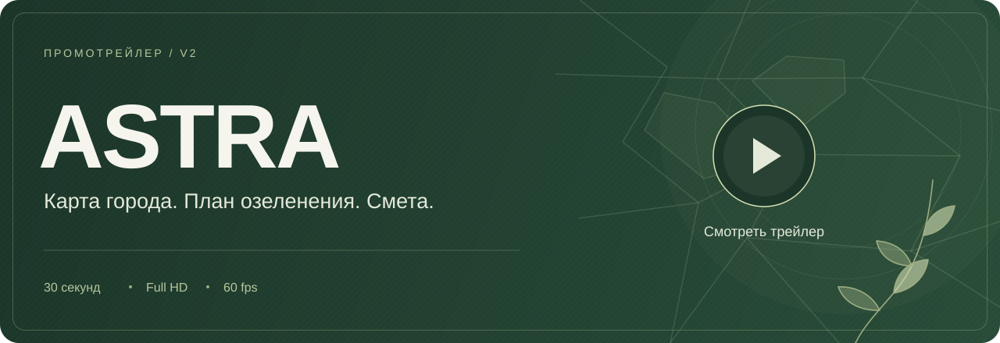
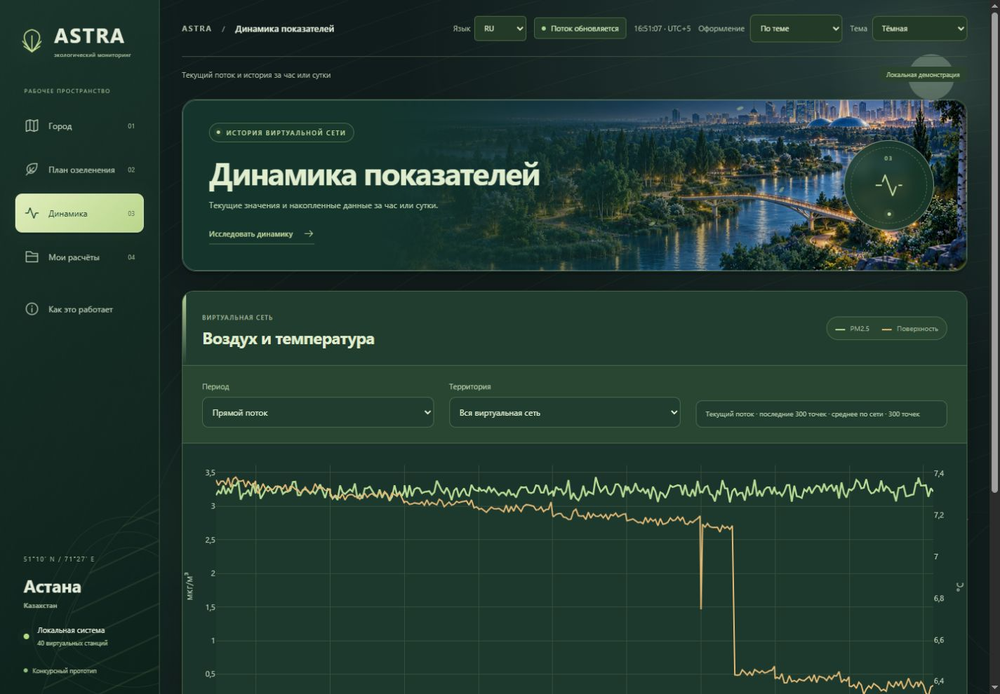

<div align="center">


**Air & Surface Temperature Real-time Analytics**

Карта городской среды, сценарии озеленения и понятная смета для Астаны.

**[Открыть ASTRA ↗](https://astra-n2xd.onrender.com/)** · Бесплатный сервер может запускаться около минуты после простоя.

<a href="#"></a>


[](VERIFICATION.md)


**[✨ Возможности](#features)** &nbsp;·&nbsp; **[🎬 Трейлер](#trailer)** &nbsp;·&nbsp; **[🧭 Как это работает](#workflow)** &nbsp;·&nbsp; **[🚀 Быстрый запуск](#quick-start)** &nbsp;·&nbsp; **[🖼️ Скриншоты](#screenshots)** &nbsp;·&nbsp; **[🌿 Расчёты и данные](#model-and-data)**

<sub>Астана, Казахстан · Планирование городского озеленения</sub>

<br/><br/>


<sub><i>Главный экран ASTRA: панорама парка, показатели воздуха Астаны и карта 40 расчётных участков</i></sub>

</div>

<br/>

<a id="trailer"></a>

##  Промотрейлер

<div align="center">

<a href="https://gl1nome5.github.io/A.S.T.R.A/" title="Открыть промотрейлер ASTRA v2">
  
</a>

**[▶ Смотреть ASTRA v2](https://gl1nome5.github.io/A.S.T.R.A/)** &nbsp;·&nbsp; **[↓ Скачать MP4](https://gl1nome5.github.io/A.S.T.R.A/ASTRA-v2.mp4)**

<sub>Короткий ролик о городской среде Астаны и планировании озеленения · 30 секунд · 1920 × 1080 · 60 fps</sub>

<sub>[Музыка и сведения об источниках](media/CREDITS.md#astra-v2)</sub>

</div>

<br/>

##  Для чего нужна ASTRA

Мелкая уличная пыль **PM2.5** и летний нагрев асфальта распределены по городу неравномерно: открытый проспект с плотным потоком машин и тихий озеленённый квартал живут в разных условиях. Когда бюджет на озеленение ограничен, городскому специалисту нужно быстро и аргументированно ответить на четыре вопроса: **где сажать деревья в первую очередь, сколько саженцев поместится на участке, какую породу выбрать и во сколько обойдётся план**.

**ASTRA** помогает собрать черновик плана озеленения. Выберите район, породу дерева (`вяз`, `сосна` или `тополь`), количество саженцев и горизонт от **1 до 30 лет**: приложение распределит деревья по приоритетным участкам с учётом сценарной вместимости, оценит эффект по модели и посчитает открытую смету в тенге. В текущем приближении крона растёт до 10-го года, затем её площадь фиксируется; расходы на уход продолжают учитываться за весь выбранный срок.

<br/>

<a id="features"></a>

##  Возможности

<table>
<tr>
<td width="50%" valign="top">

 **Карта 40 участков Астаны**<br/>
<sub>Пять пилотных групп районов (Есиль, Нура, Алматы, Сарыарка, Байконыр) с оценкой пыли, нагрева поверхности, зелени и вместимости посадок.</sub>

 **Умный подбор мест посадки**<br/>
<sub>Распределение выбранной породы по приоритетным участкам с учётом сценарной вместимости: от 180 до 650 деревьев на участок. Реальную возможность посадки нужно подтвердить обследованием.</sub>

 **Открытая смета в тенге**<br/>
<sub>Расчёт стоимости саженцев, посадки, ежегодного ухода, оборудования и сопровождения на 1-й год и на выбранный срок с ручной правкой расценок.</sub>

 **Прогноз на 3 часа**<br/>
<sub>Для PM2.5 основное правило сохраняет текущий уровень; для индекса нагрузки ESI работает LightGBM. SHAP объясняет прогнозы LightGBM, включая экспериментальный вариант PM2.5. Качество проверено на синтетических данных.</sub>

</td>
<td width="50%" valign="top">

 **Архив на 30 дней и A/B-сравнение**<br/>
<sub>Сохраняйте расчёты в локальную базу, открывайте их без скрытого пересчёта и сравнивайте два варианта плана бок о бок.</sub>

 **Готовый печатный отчёт А4**<br/>
<sub>Отчёт с ведомостью участков, параметрами породы, графиком сметы и источниками. Его можно сохранить в PDF через диалог печати браузера.</sub>

 **Фоновые данные и автономный расчёт**<br/>
<sub>Опрос Open-Meteo / CAMS каждые 5 минут по умолчанию. При недоступности API расчёт использует кэш или резервные значения; загрузка картографической подложки требует интернета.</sub>

 **Три языка и три темы оформления**<br/>
<sub>Интерфейс и печатный отчёт на русском, казахском и английском (`RU / ҚАЗ / EN`), а также лесная дневная, тёмная и зимняя темы с живой природой.</sub>

</td>
</tr>
</table>

<br/>

<a id="workflow"></a>

##  Как это работает

<div align="center">

<table>
<tr>
<td align="center" width="25%"><br/><b>1. Погода и фон воздуха</b><br/><sub>опрос API каждые 5 минут; при сбое — кэш или резервный фон</sub></td>
<td align="center" width="25%"><br/><b>2. Оценка 40 участков</b><br/><sub>пыль PM2.5, нагрев земли, трафик, зелень и прогноз +3 ч</sub></td>
<td align="center" width="25%"><br/><b>3. Распределение деревьев</b><br/><sub>выбор породы, района и отбор улиц по лимиту мест</sub></td>
<td align="center" width="25%"><br/><b>4. Смета и отчёт А4</b><br/><sub>бюджет в тенге, сравнение вариантов A/B и выгрузка в PDF</sub></td>
</tr>
</table>

</div>

<br/>

<a id="quick-start"></a>

##  Быстрый запуск

> [!TIP]
> Для локального запуска нужен **Python 3.12**. После первой установки приложение открывается двойным кликом по **`start.cmd`**.

**1.** Клонируйте проект и создайте виртуальное окружение (Windows PowerShell):

```powershell
git clone https://github.com/GL1NoMe5/A.S.T.R.A.git
cd A.S.T.R.A
py -3.12 -m venv .venv
.\.venv\Scripts\python.exe -m pip install -r requirements.lock.txt
```

**2.** Запустите сервер:

```powershell
.\start.cmd
```

**3.** Откройте **[http://127.0.0.1:8010/](http://127.0.0.1:8010/)** в браузере 🌿

**Размещение в интернете:** [инструкция для Render + Neon](docs/HOSTING.md). Конфигурация бесплатного веб-сервиса — [`render.yaml`](render.yaml); база подключается отдельной секретной переменной.

Если погодный API Open-Meteo временно недоступен, приложение использует открытый модельный прогноз **MET Norway Locationforecast** (CC BY 4.0). Фактический источник и время данных сохраняются в расчёте и показываются в сведениях об источниках и отчёте.

<details>
<summary><b>🐧 Запуск на Linux / macOS и в Docker</b></summary>

<br/>

**Linux / macOS:**

```bash
python3.12 -m venv .venv
source .venv/bin/activate
pip install -r requirements.txt
python scripts/run_local.py
```

**Docker Compose (PostgreSQL + Redis, порт 8000):**

```bash
docker compose up --build
```

Дополнительные ключи для `start.cmd` на Windows:
- `.\start.cmd --check` проверяет окружение и зависимости без старта окна;
- `.\start.cmd --offline` отключает серверный опрос Open-Meteo: используется кэш или резервный фон. Браузер по-прежнему может запрашивать тайлы OpenStreetMap; без сети подложка может отсутствовать.

Настройки переменных окружения описаны в [`.env.example`](.env.example) и [`docs/TECHNICAL.md`](docs/TECHNICAL.md).

</details>

<details>
<summary><b>🧪 Автотесты и короткая сквозная проверка</b></summary>

<br/>

```powershell
.\.venv\Scripts\python.exe scripts/check.py --javascript
.\.venv\Scripts\python.exe scripts/acceptance.py --seconds 30
```

Для JavaScript-проверок нужен **Node.js** в `PATH` (либо ключ `--node` с путём к нему). Зафиксированный прогон от 26.10.2026: **54 Python-теста и 27 JavaScript-тестов**, всего **81**. Они проверяют логику приложения, отчёт, переводы и управление анимациями; это не замер плавности в браузере. Вторая команда запускает отдельную приёмку с 30 секундами потока, перезапуском сервера и проверкой сохранности данных в SQLite WAL. Рабочая база не затрагивается. Подробный отчёт: [`VERIFICATION.md`](VERIFICATION.md).

</details>

<br/>

<a id="screenshots"></a>

##  Скриншоты

<div align="center">


<sub><b>Раздел аналитики: динамика показателей, сравнение прогнозов и объяснение факторов</b></sub>

<br/><br/>

<table>
<tr>
<td width="50%"><p align="center"><sub><b>Планирование посадок и смета в тенге</b></sub></p></td>
<td width="50%"><p align="center"><sub><b>Архив планов на 30 дней и A/B-сравнение</b></sub></p></td>
</tr>
<tr>
<td width="50%"><p align="center"><sub><b>Тёмная тема оформления</b></sub></p></td>
<td width="50%"><p align="center"><sub><b>Зимняя тема оформления</b></sub></p></td>
</tr>
</table>

</div>

<br/>

<a id="model-and-data"></a>

##  Расчёты, данные и ограничения

ASTRA — программный прототип для сравнения сценариев озеленения. Ниже описаны доступные функции, примеры расчётов и проверки, необходимые перед практическим внедрением.

- **Реализовано:** карта расчётных участков, прогнозы, распределение деревьев, смета, сохранение и сравнение планов, печатный отчёт. Программная логика проверяется автотестами и синтетическими стендами.
- **Предстоит проверить:** потребность пользователей через интервью, пригодность участков и параметры пород, точность прогноза и фактический эффект посадок. Партнёры, полевые испытания, продажи и финансирование пока не подтверждены.

### Воспроизводимый пример (`1 000` вязов · `10` лет · +28 °C · ветер 1 м/с)

Это фиксированный синтетический сценарий из [стенда озеленения](benchmarks/greening/README.md), а не текущая погода или измеренный результат в Астане. PM2.5 и охлаждение ниже усреднены по площади **всех 40 участков**, включая участки без посадок. В приложении средние относятся только к участкам выбранного плана, поэтому значения отличаются.

| Параметр сценария | Результат модели | Пояснение и границы оценки |
|---|---|---|
| **Распределение деревьев** | **`1 000` из `1 000`**, остаток `0` | Все деревья распределены в пределах сценарной вместимости. При допущении о приживаемости `85%` модель учитывает `850` живых деревьев и `21 250 м²` кроны к 10-му году. |
| **Снижение пыли PM2.5** | **`0,0902 мкг/м³`** | У равномерного распределения по тем же выбранным участкам — `0,0896 мкг/м³`. Разница мала и не доказывает значимый эффект в реальном городе. |
| **Охлаждение поверхности** | **`0,0352 °C`** | У равномерного распределения — `0,0363 °C`: по этому показателю результат ASTRA ниже. Температурный множитель модели равен нулю до `+10 °C` и достигает максимума при `+30 °C`. |
| **Поглощение CO₂** | **`18,7 т CO₂/год`** к 10-му году | Расчёт `850 × 22 кг/год`. Коэффициент `22 кг` — сценарное допущение, не подтверждённая для Астаны норма. Это годовой поток, а не сумма за 10 лет. |

Числа и распределения опубликованы в [results.json](benchmarks/greening/results.json); формулы и ограничения — в [реестре модели](docs/PROJECT_EVIDENCE.md#реестр-модели).

### Три раздельных предварительных бюджета

| Контур расходов | Предварительная оценка | Что входит в расчёт |
|---|---|---|
| **1. Смета самой посадки в приложении** (`1 000` вязов) | **`29,8 млн ₸`** в 1-й год<br/>**`67,6 млн ₸`** за 10 лет | Саженцы и посадка `25,0 млн ₸` (`15 000 + 10 000 ₸` × `1 000`), уход 1-го года `3,0 млн ₸`, базовые датчики `0,6 млн ₸` и сопровождение `1,2 млн ₸/год`. Любую расценку можно изменить вручную. |
| **2. Шестинедельный пилот проверки данных** (`4` участка) | **`1,13–2,71 млн ₸`**<br/>*(с резервом 15%)* | Проверка на 2 участках посадки и 2 контрольных улицах: инженер данных, консультант-эколог, аренда 4 датчиков PM2.5 на 2 месяца, сверка с постом Казгидромета и замеры нагрева покрытий. |
| **3. Годовая поддержка веб-сервиса** *(после пилота)* | **`0,74–2,32 млн ₸/год`** | Облачный сервер, резервные копии, техническая поддержка (`8–16 ч/мес`) и контроль качества данных (`4–8 ч/мес`) для одного города. |

> [!NOTE]
> Все три суммы являются предварительными плановыми оценками, а не коммерческими офертами или полученной выручкой. Пункты 2 и 3 не включают закупку саженцев и частично пересекаются со строками оборудования и сопровождения из сметы 1, поэтому напрямую между собой не складываются.

Расшифровка ставок и ресурсов — в [реестре бюджетов](docs/PROJECT_EVIDENCE.md#три-разных-бюджета). Налоги, доставка, поливная инфраструктура, замена погибших деревьев и условия доступа к данным требуют отдельного уточнения перед внедрением.

<br/>

<details>
<summary><b>🌱 Экологическая проблема Астаны и источники данных</b></summary>

<br/>

- **Контекст города:** в публикации от 02.07.2025 Казгидромет сообщал о **10 стационарных постах** в Астане, включая 6 автоматических, и необходимости обновления сети из-за изменившейся застройки. Это сведения на дату публикации, а не подтверждение нынешнего числа постов. [Источник](https://www.kazhydromet.kz/ru/post/3021). По данным Бюро национальной статистики, выбросы от стационарных источников в Астане за 2025 год составили **53,7 тыс. т**; это масса выбросов всех учитываемых загрязнителей, а не концентрация PM2.5. [Таблица по регионам](https://stat.gov.kz/ru/industries/environment/stat-eco/publications/346639/).
- **Источники данных:** приложение опрашивает **Open-Meteo / CAMS Global** каждые 5 минут по умолчанию. Это частота запросов приложения; новые исходные данные появляются по расписанию поставщика. Сетка CAMS Global для загрязнителей — около **45 км**. Показатели **40 участков** рассчитываются локальной моделью от общего фона с учётом сценарных трафика, зелени и застройки: **это не сеть из 40 физических станций**. [Документация API](https://open-meteo.com/en/docs/air-quality-api).
- **Потребность пользователя:** предполагаем, что специалистам нужен быстрый способ сравнить планы озеленения и сметы. Это гипотеза; для её проверки подготовлены [вопросы для 3–5 интервью](docs/PROJECT_EVIDENCE.md#проблема-и-потребность), сами интервью ещё не проведены.

</details>

<details>
<summary><b>🧠 Прогноз на 3 часа, проверка моделей и баланс посадок</b></summary>

<br/>

- **Выбор прогноза PM2.5:** на трёх временных блоках **синтетических данных** (по `640` проверочных строк, seed `42`) сохранение текущего уровня (*persistence*) дало среднюю абсолютную ошибку **`MAE = 1,94 мкг/м³`**, модель LightGBM с поправкой — `2,20 мкг/м³`, прежний прямой LightGBM — `10,36 мкг/м³`. Поэтому основным прогнозом PM2.5 оставлено сохранение текущего значения, а LightGBM доступен для сравнения. [Протокол и результаты](benchmarks/pm25/README.md).
- **Прогноз ESI (+3 ч):** на другом, ранее известном контрольном отрезке (`100–124`, `1 000` строк, seed `42`) LightGBM получил **`MAE = 1,22`** против **`1,86`** у persistence и используется как основной. Это не новый независимый контроль; точность на реальных наблюдениях Астаны не установлена. ESI — собственный индекс нагрузки, не нормативная или медицинская шкала.
- **Роль SHAP:** `SHAP TreeExplainer` показывает вклад факторов в прогноз LightGBM. Основной прогноз PM2.5 объясняется правилом сохранения значения, без SHAP. Ни одно из этих объяснений не доказывает физический эффект посадок.
- **Проверка распределения деревьев (`36` сценариев):** в [синтетическом стенде](benchmarks/greening/README.md) ASTRA дала большее модельное снижение PM2.5 во всех **36 из 36** случаев, но меньшее охлаждение в **24 тёплых случаях**. Основной ориентир — равномерное распределение по тем же выбранным участкам с теми же ограничениями. Проверка оценивает распределение деревьев, но не доказывает качество выбора участков или превосходство на реальных данных.

</details>

<details>
<summary><b>🏙️ Сравнение с аналогами, пользователи и план пилота</b></summary>

<br/>

- **Место среди аналогов:** Казгидромет ведёт официальный мониторинг. В семействе [i-Tree](https://www.itreetools.org/tools) Eco оценивает выгоды деревьев по инвентаризации или полевым данным, Landscape помогает выбирать места посадки по слоям крон и переписи США, Planting моделирует будущие выгоды посадок. ASTRA адаптирует связанный процесс расчёта к сценарным участкам Астаны, смете в тенге и языкам `RU / ҚАЗ / EN`. Это локальная адаптация, не заявление о мировой уникальности или превосходстве над этими инструментами.
- **Кому нужен сервис:** основные пользователи: специалисты управлений экологии, районных служб озеленения и подрядчики благоустройства; потенциальный заказчик пилота и годовой поддержки: городская организация либо грантовая программа.
- **План пилота в Астане:**
  1. **Этап 1 (6 недель · проверка данных и удобства работы):** выбор 4 участков (2 участка посадки + 2 контрольных), сверка недорогих датчиков PM2.5 рядом с постом Казгидромета, замеры нагрева покрытий и тестирование интерфейса со специалистами.
  2. **Этап 2 (полный тёплый сезон с агрономом):** учёт реальной приживаемости саженцев по породам, сравнение пыли и температуры «до и после» относительно контрольных улиц и калибровка коэффициентов модели по полевым данным Астаны.
- **Что оценивать:** полноту и погрешность данных, время подготовки плана специалистом, понятность расчёта; на сезонном этапе — приживаемость, PM2.5 и температуру поверхности относительно контрольных улиц с учётом погоды. За шесть недель нельзя доказать эффект взрослых деревьев. Участки, доступ к эталонному посту и партнёры пока не согласованы; [протокол пилота](docs/TECHNICAL.md#предлагаемый-пилот-astra) описывает последовательность проверки.
- **Как поддерживать сервис:** рассматриваются оплачиваемый пилот, годовое сопровождение, грант или партнёрская поддержка. Готовность платить и цены предстоит проверить. Следующие этапы развития — калибровка на полевых данных и согласование пригодных участков; расширение на другие районы и города требует местных данных и проверки модели.

</details>

<details>
<summary><b>🤖 Роль ИИ, источники и документация</b></summary>

<br/>

- **Раскрытие использования ИИ:** внутри приложения LightGBM строит прогнозы, SHAP объясняет их. Gemini помогал с первоначальной концепцией; Codex — с архитектурой, кодом, тестами, документацией и проверкой интеграции; Argon — с отчётом, исследовательским стендом и материалами проекта; Opus в Antigravity — с оформлением и анимациями. Автотесты проверяют программную логику, но не подтверждают полевые коэффициенты или спрос. Команда отвечает за понимание, проверку и представление результата.
- **Подробная документация репозитория:**
  - [`docs/TECHNICAL.md`](docs/TECHNICAL.md): архитектура, API, формулы и устройство базы данных;
  - [`docs/PROJECT_EVIDENCE.md`](docs/PROJECT_EVIDENCE.md): полный реестр источников, коэффициентов, смет и допущений;
  - [`docs/PILOT_NETWORK.md`](docs/PILOT_NETWORK.md): описание 40 расчётных участков Астаны;
  - [`docs/ATLAS_DESIGN.md`](docs/ATLAS_DESIGN.md): дизайн-система, темы и графические материалы;
  - [`VERIFICATION.md`](VERIFICATION.md) и [`benchmarks/`](benchmarks/): результаты автотестов и воспроизводимых проверок;
  - [`examples/README.md`](examples/README.md): пример JSON-выгрузки сохранённого расчёта.

```text
app/          Сервер FastAPI, модели прогноза и оптимизации, 40 участков и веб-интерфейс
benchmarks/   Воспроизводимые проверки прогноза PM2.5/ESI и алгоритма посадок (36 сценариев)
docs/         Техническая документация, доказательная база, скриншоты и пакет презентации
examples/     Эталонный JSON-пример сохранённого расчёта
media/        Готовые демонстрационные видеоролики (Full HD, 60 fps) и сведения о правах
scripts/      Скрипты локального запуска, диагностики и приёмочного прогона
tests/        Автотесты серверной логики, отчёта, переводов и управления анимациями
```

</details>

<br/>

<div align="center">

<table>
<tr>
<td></td>
<td></td>
<td></td>
<td></td>
<td></td>
<td></td>
<td></td>
<td></td>
<td></td>
</tr>
</table>

<i>«Сажать деревья там, где улице больше всего не хватает тени и свежего воздуха, и проверять каждый расчёт делом.»</i><br/>
<sub>⭐ Если проект ASTRA показался вам полезным и аккуратно собранным, поддержите репозиторий звёздочкой!</sub>

</div>

<br/>

---

<div align="center">

<sub>Сделано с заботой о городской среде Астаны.</sub><br/>
<sub><i>Код по лицензии <a href="LICENSE">MIT</a> · Фоновые данные воздуха и погоды: Open-Meteo / CAMS (<a href="https://creativecommons.org/licenses/by/4.0/">CC BY 4.0</a>) · Карта: <a href="https://www.openstreetmap.org/copyright">OpenStreetMap (ODbL)</a> · <a href="THIRD_PARTY_NOTICES.md">Сторонние компоненты</a> · <a href="media/CREDITS.md">Материалы демо</a></i></sub>

<br/><br/>


</div>
